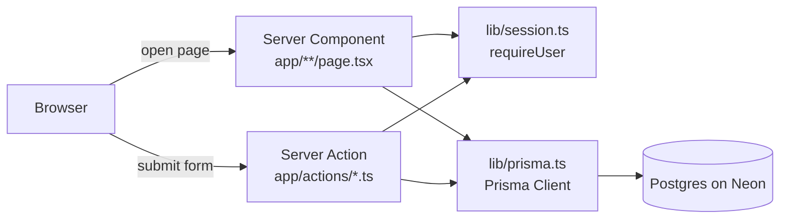
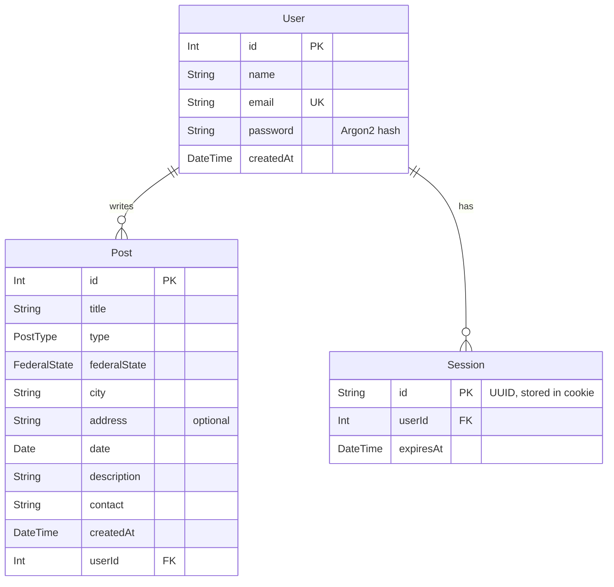
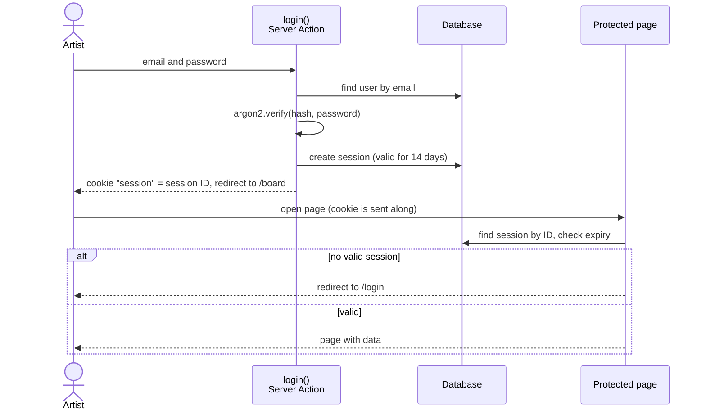

# Architecture

## Overview

Ink-Board is a single Next.js app. There is no separate backend: pages are rendered on the server as Server Components and read from the database directly with Prisma. Forms call Server Actions, which write data.



## Server and Client Components

| Type | Where | Why |
|---|---|---|
| Server Components | all pages in `app/` | read data and check the session on the server |
| Client Component | `app/components/Nav.tsx` | needs `usePathname` to highlight the active link |
| Server Actions | `app/actions/auth.ts`, `app/actions/posts.ts` | register, log in, log out, create and edit posts |

## Data Model



- `PostType` and `FederalState` are enums. Their German labels are in `lib/labels.ts`.
- When a user is deleted, the database also deletes their posts and sessions (`onDelete: Cascade`).

## Authentication

Authentication is custom-built, without an auth library. Passwords are hashed with Argon2id. The session is stored in the database; the browser only receives its ID as an `httpOnly` cookie.



## Who May Change What

- `requireUser()` in `lib/session.ts` protects every page and every Server Action that needs a logged-in user.
- `requireOwnPost(id)` in `lib/posts.ts` additionally checks whether the post belongs to the logged-in user. The check runs on the server, not just by hiding buttons. A forged `id` field in the form is therefore not enough to change someone else's post.

## Deployment

Vercel builds the app on every push to `main`. The build command is defined in `vercel.json`:

```
prisma generate → prisma migrate deploy → prisma db seed → next build
```

The seed only adds sample data if no user exists yet.
